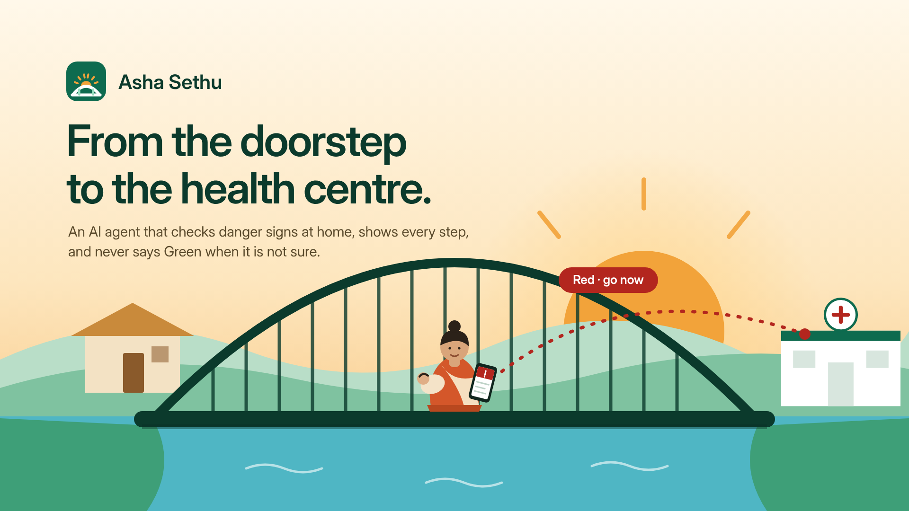
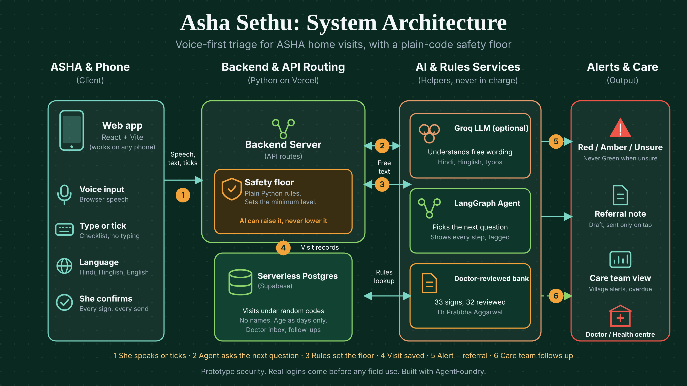

<p align="center"></p>

# Asha Sethu

**A second pair of eyes for every ASHA home visit.**
*Sethu* means bridge. The app carries a danger sign from the doorstep to the health centre while the health worker is still there.

Built for **Code for a Billion**, with AgentFoundry.

---

## The problem, in plain words

India has about 1.05 million ASHA workers. They walk from house to house in villages and check on mothers and newborns. Most have community training, not clinical education.

At the door, they hear things like *"baby won't feed, feels warm"* or *"mother has a severe headache"*, said in local dialects. Signs of birth asphyxia or newborn sepsis can be missed, or noticed too late. Then the referral is late too.

- **Who is hurt:** pregnant mothers and newborns in rural India, and the ASHAs who work without any real-time clinical help.
- **What exists today:** government tools are mostly data-entry forms with drop-down menus. They do not understand Hindi or Hinglish, and they do not advise anyone during a visit.

## What Asha Sethu does

1. **She describes the visit.** She speaks, types, or ticks a checklist, in Hindi, Hinglish or English.
2. **The app checks danger signs.** An AI agent asks only the one question that could change the danger level, and shows every step it took.
3. **A safety floor decides the minimum level.** It is plain code, not AI. The AI can raise the level but never lower it. If the app is unsure it says **Unsure**, never Green.
4. **A draft referral is ready.** The note and visit record are filled in. Nothing is saved or sent until the worker taps.
5. **The care team can follow up.** A doctor inbox, village alerts, and overdue follow-ups.

Everything the app does is shown on screen with a tag: *AI suggested*, *Worker confirmed*, *From rules*, or *Done*.

<p align="center"></p>

### Tech stack

| Part | What we used | Why |
|---|---|---|
| App | React + Vite | Fast, works in any phone browser |
| API | Small Python functions on Vercel | One place for the safety rules |
| Safety floor | Plain Python, reviewed rules (`data/rules.json`) | Predictable and testable. No AI involved |
| Agent | LangGraph | Chooses the next question and records each step |
| Language model | Groq (optional) | Understands free wording. The app still works without it |
| Database | Supabase Postgres | Visits stored under random codes. No names, age stored as days |

## Medical review

The danger-sign levels (rules **v0.3.1**) were reviewed by **Dr Pratibha Aggarwal**, obstetrician, gynaecologist and IVF specialist with over 35 years of experience, practising in New Delhi and Gurugram. Review date: 15 November 2026.

- 32 of 33 signs carry a reviewed verdict, with a source and version.
- One sign (heavy bleeding) is still pending and stays at **Red** until settled.
- The newborn signs have not had a paediatric review yet.

**Asha Sethu is an alert aid, not a diagnosis tool, and is not clinically validated.**

## How well does it work?

We tested 104 written cases (English, Hindi, Hinglish) against a simple keyword checker that only reads English.

| | Keyword checker | Asha Sethu |
|---|---|---|
| Red cases caught | 32 of 55 | **55 of 55** |
| Overall level accuracy | 53% | **99%** |
| Hindi cases correct | 20% | **100%** |
| Hinglish cases correct | 7% | **100%** |

Be careful with these numbers: the cases were written by us, so real-world scores will be lower. One known miss: *"baby is feeding well and looks fine"* returns Unsure. That is safe, but not ideal. The floor tests check that the code follows the rules. They do not check the medicine.

## The scale of the problem

| | Number | Source |
|---|---|---|
| Newborn deaths | 19 per 1,000 live births (2021) | SRS 2021, Registrar General of India |
| Infant deaths | 27 per 1,000 live births (2021) | SRS 2021 |
| Maternal deaths | 93 per 100,000 live births (2019-21) | SRS special bulletin |
| ASHA workers | about 1.05 million | Ministry of Health and Family Welfare |

## Try it

- **Live app:** `https://YOUR-APP.vercel.app` (replace with your link)
- On a laptop you get this story page with the app inside a phone. Press **Play guided demo**.
- On a phone, the same link opens only the app, full screen.
- **Care team view:** add `#care` to the link. It asks for an access code (a prototype gate).

## Run it yourself

```bash
git clone <this repo>
cd asha-sethu
pip install -r requirements.txt
cd web && npm install && cd ..
python api/dev.py        # API on port 8000
cd web && npm run dev    # app on port 5173
```

Copy `.env.example` to `.env`:

| Variable | What for |
|---|---|
| `SUPABASE_URL`, `SUPABASE_SERVICE_ROLE_KEY` | Saving visits (server only, never in the browser) |
| `GROQ_API_KEY`, `GROQ_MODEL` | Optional language model |
| `AGENT_ENGINE` | Optional. Choose the agent engine |
| `CARE_ACCESS_CODE` | Access code for the care team view |

Tests: `python api/test_rules.py`, `test_agent.py`, `test_note.py`, `test_care.py`. Scores: `python api/eval.py`.

## Honest limits

- Prototype security. The care team code is a gate, not real security. **Real logins and audit logs come before any field use.**
- No field pilot yet. A shadow pilot with real ASHAs is planned, not done.
- The Hindi wording of newer questions needs a Hindi-speaking reviewer.
- Source page numbers are still being confirmed for most signs. One sign (no cry at birth) has no matching source wording yet.

## Credits

Built by Shivansh Sharma, BITS Pilani Goa. Clinical review by Dr Pratibha Aggarwal. Built with AgentFoundry.
